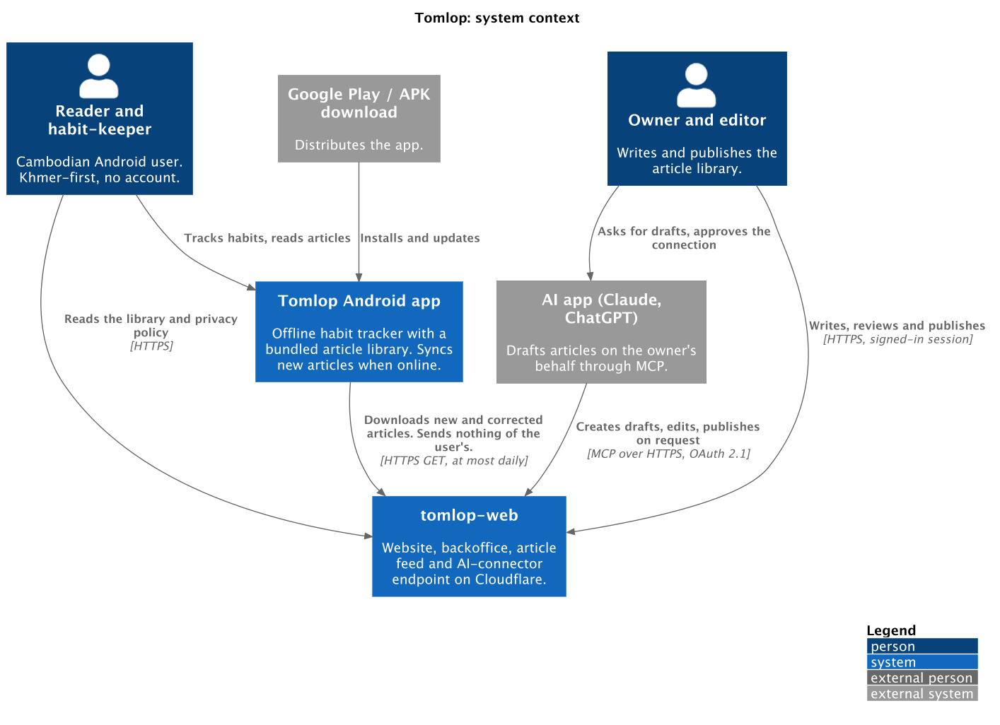
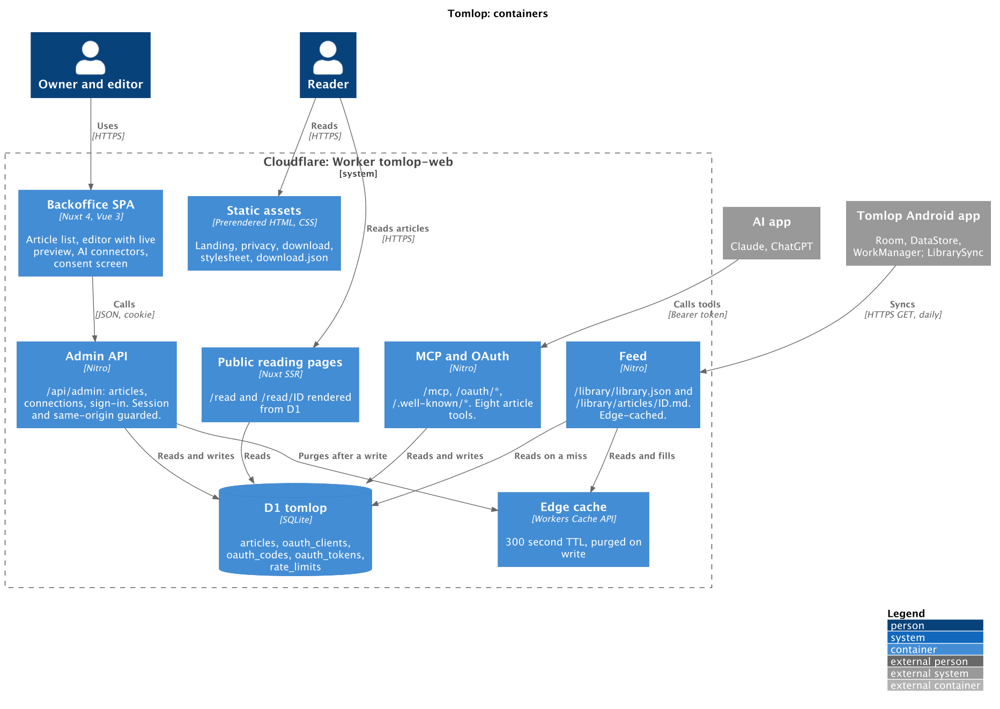
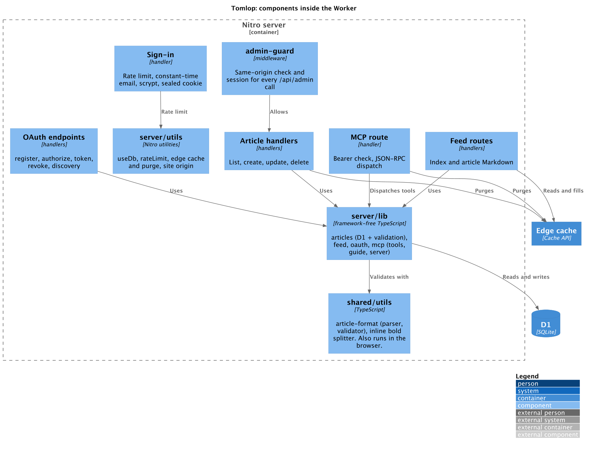

# Tomlop: C4 architecture

Domain: whole product · ADRs: [0001](../adr/0001-nuxt-on-cloudflare-workers-with-d1.md), [0002](../adr/0002-feed-is-a-contract-with-a-bundled-floor.md), [0004](../adr/0004-ai-authoring-through-mcp-with-oauth.md) · ERD: [erd_content](../erd/erd_content.md) · Flows: [content](../flows/content/), [ai](../flows/ai/), [admin](../flows/admin/)

## Level 1: system context

## Level 2: containers

## Level 3: components inside the Worker

## Key design decisions visible in the diagrams
| Decision | Where to see it | ADR |
|---|---|---|
| One Worker, one D1, static pages served without waking the Worker | Container diagram | 0001 |
| The app only downloads; the user's data never leaves the phone | Context: the app to web arrow | 0002 |
| The same validator runs in the browser and on the server | Component diagram: `shared/utils` | 0005 |
| Public feed is cached and purged on write | Container: edge cache | 0006 |
| AI apps enter through `/mcp` with OAuth, not through the admin session | Container: MCP and OAuth | 0004 |

Sources: `assets/*.puml`. Render with `plantuml -tpng -Sdpi=130 file.puml`; commit the PNG with the source.
