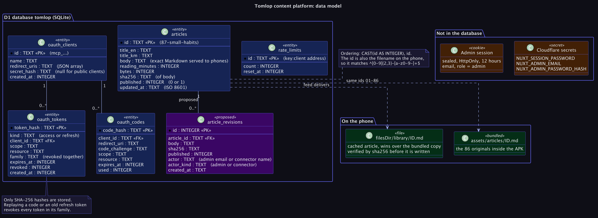

# Content platform: entity and data model

Domain: Content & Publishing · ADRs: [0001](../adr/0001-nuxt-on-cloudflare-workers-with-d1.md), [0002](../adr/0002-feed-is-a-contract-with-a-bundled-floor.md), [0004](../adr/0004-ai-authoring-through-mcp-with-oauth.md), [0008](../adr/0008-article-revision-history.md) (proposed) · Flows: [FS-CONTENT-01](../flows/content/fs_content_01_article_authoring.md), [FS-CONTENT-02](../flows/content/fs_content_02_feed_sync.md), [FS-AI-01](../flows/ai/fs_ai_01_connector_oauth_mcp.md)
Migrations: `migrations/0001_articles.sql`, `0002_oauth.sql`, `0003_rate_limits.sql`.

## Diagram

Purple is **proposed**, not built.

## D1 (SQLite)
### `articles`
| Column | Type | Notes |
|---|---|---|
| `id` | TEXT PK | `87-small-habits`. Also the filename on phones. Pattern `^\d{2,3}-[a-z0-9]+(-[a-z0-9]+)*$`. Orders by `CAST(id AS INTEGER), id` |
| `title_en`, `title_km` | TEXT | Derived from the heading `# English / ខ្មែរ` on every save |
| `body` | TEXT | The exact Markdown served to phones, with line endings normalised and one trailing newline |
| `reading_minutes` | INTEGER | `max(1, floor(characters / 550) + 1)`, the app's formula |
| `bytes` | INTEGER | UTF-8 length of `body` |
| `sha256` | TEXT | Hex SHA-256 of `body`; the integrity value in the feed and the ETag |
| `published` | INTEGER | 0 draft, 1 published. Index `articles_published` |
| `updated_at` | TEXT | ISO 8601 UTC, seconds. The feed's `generatedAt` is the maximum |

3NF check: every non-key column depends on `id`. The derived columns are stored, not recomputed, to keep the feed index a metadata-only read; they are rewritten together with `body` on every save, never separately.

### `oauth_clients`, `oauth_codes`, `oauth_tokens`
| Table | Key columns | Notes |
|---|---|---|
| `oauth_clients` | `id` PK (`mcp_…`), `name`, `redirect_uris` (JSON array), `secret_hash` (null for public clients), `created_at` | One row per connection attempt; the admin can clear unfinished ones |
| `oauth_codes` | `code_hash` PK, `client_id`, `redirect_uri`, `code_challenge`, `scope`, `resource`, `expires_at`, `used` | Hashes only, 5 minutes, single use |
| `oauth_tokens` | `token_hash` PK, `kind` (`access`/`refresh`), `client_id`, `scope`, `resource`, `family`, `expires_at`, `revoked`, `created_at` | Hashes only. `family` groups every token from one authorization so a replay revokes them all. Indexes on `client_id` and `family` |

Enum-like columns (`kind`) are enforced in code, not with `CHECK`; adding `CHECK (kind IN ('access','refresh'))` is a cheap hardening step for the next migration.
Expired rows are never deleted today (see the roadmap: a scheduled prune).

### `rate_limits`
`id` PK (`<key>:<client address>`), `count`, `reset_at`. A fixed window per key. Rows linger until the same key returns.

### `article_revisions` (proposed, ADR 0008)
`id` INTEGER PK, `article_id` FK, `body`, `sha256`, `published`, `actor`, `actor_kind` (`admin`/`connector`), `created_at`. Append-only; written in the same batch as the change.

## Not in the database
| Item | Where | Notes |
|---|---|---|
| Admin session | Sealed HttpOnly cookie | 12 hours, no server state |
| Admin identity and password hash | Cloudflare secrets | `NUXT_ADMIN_EMAIL`, `NUXT_ADMIN_PASSWORD_HASH` |
| Session key | Cloudflare secret | `NUXT_SESSION_PASSWORD`; rotating it signs everyone out |

## On the phone
Cached articles live in `filesDir/library/<id>.md` with a `last-sync` stamp; bundled ones in `assets/articles/`. A cached file replaces the bundled one with the same id at load time.
