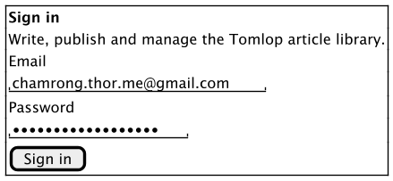
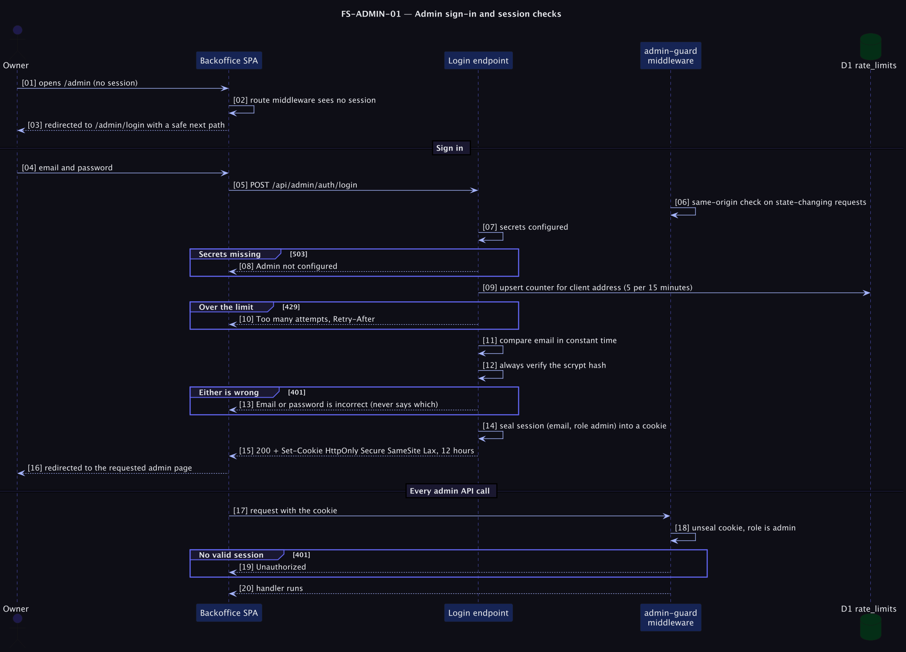

# FS-ADMIN-01 — Admin sign-in and session checks

## Table of Contents
1. [Meta](#1-meta-information) · 2. [Description](#2-description--use-case) · 3. [Pre/Post-conditions](#3-pre-conditions--post-conditions) · 4. [Contracts](#4-rest-api-endpoint-contracts) · 5. [Controls & States](#5-controls--states) · 6. [UI](#6-ui-flow--screen-wireframes) · 7. [Email](#7-email-templates) · 8. [Sequence](#8-technical-sequence-flows) · 9. [Security](#9-security--operational-controls) · 10. [Changes](#10-change-history) · 11. [Sign-off](#11-business-owner-sign-off)

## 1. Meta Information
| Field | Value |
|---|---|
| Flow ID | `FS-ADMIN-01` |
| Subdomain | Identity & Access |
| Status | Approved (as built) |
| Version | 1.0.0 |
| Created | 2026-10-26 |
| Author | Chamrong, with Claude |

## 2. Description & Use Case
### 2.1 Business & UX Overview
One person, the owner, signs in with an email and a long password. The page says plainly what went wrong and what to do next ("Too many attempts. Wait a few minutes, then try again."), never reveals whether the email or the password was wrong, and returns the owner to the page they were heading for.
### 2.2 Technical System Logic
[ADR 0003](../../adr/0003-single-admin-sealed-session.md) · `server/api/admin/auth/login.post.ts`, `server/middleware/admin-guard.ts`, `app/middleware/admin-auth.ts`, `nuxt-auth-utils` for the sealed cookie.

## 3. Pre-conditions & Post-conditions
| Pre-conditions | Post-conditions |
|---|---|
| `NUXT_SESSION_PASSWORD`, `NUXT_ADMIN_EMAIL`, `NUXT_ADMIN_PASSWORD_HASH` are Cloudflare secrets | A sealed session cookie for 12 hours |
| The password was hashed with `npm run hash-password` (12+ characters) | The SPA's `next` target is used only if it starts with `/admin` and not `//` |

## 4. REST API Endpoint Contracts
### 4.1 `POST /api/admin/auth/login`
Body `{ email, password }`. `200` `{ ok: true }` + `Set-Cookie: tomlop-admin=…; HttpOnly; Secure; SameSite=Lax; Max-Age 12 h` · `400` malformed · `401` wrong credentials · `403` cross-origin · `429` over the limit (`Retry-After`) · `503` secrets missing.
### 4.2 `POST /api/admin/auth/logout`
Clears the session. `200`.
### 4.3 Every other `/api/admin/*`
`401` without a valid admin session · `403` cross-origin on non-GET · `503` if the session secret is missing.

## 5. Controls & States
| Item | Rule |
|---|---|
| Attempts | 5 per 15 minutes per client address, counted in D1 (shared by all Worker isolates) |
| Timing | The password hash is verified even when the email is wrong; emails compare in constant time |
| Session | 12 hours, sealed (encrypted and signed), HttpOnly, Secure, SameSite=Lax; no server-side session table |
| Sign-out | Clears this browser's cookie. There is no "sign out everywhere"; rotating `NUXT_SESSION_PASSWORD` invalidates every session |
| Recovery | Set a new hash with `wrangler secret put` (see the [runbook](../../runbook.md)) |
| Local only | `NUXT_SESSION_COOKIE_SECURE=false` allows plain-HTTP testing; never set in production |

## 6. UI Flow & Screen Wireframes

States: idle, submitting ("Signing in…", button busy), error (alert with a recovery), redirected.

## 7. Email Templates
Not applicable: no email-based reset (see O1).

## 8. Technical Sequence Flows

## 9. Security & Operational Controls
| Control | ASVS 5.0.0 (per quick reference) |
|---|---|
| Rate limiting of sign-in attempts | 6.3.1 |
| No account/credential enumeration in replies or timing | 6.3.8 |
| Sealed, HttpOnly, Secure, SameSite session cookie; no token in `localStorage` | 3.3.1, 3.3.2, 3.3.4 |
| Same-origin check for state-changing requests | 3.5.1 |
| Password strength enforced when the hash is created (12+) | 6.2.1, 6.2.4 |
| Localised, recoverable error messages | 16.5.1 |

Known gaps: no MFA, no lockout beyond the rate limit, no audit trail of sign-ins. Cloudflare Access in front of `/admin*` adds MFA and a second log; it is recommended before a second author exists.
IDs come from the flow-doc quick reference; confirm against ASVS 5.0.0 before any formal audit.

## 10. Change History
| Version | Date | Change |
|---|---|---|
| 1.0.0 | 2026-10-26 | First spec, written from the built behaviour |

## 11. Business Owner Sign-off
### 11.1 Decisions
**D1** One admin and one password. · **D2** Sealed cookie instead of a session table. · **D3** Rate limit in D1, not memory.
### 11.2 Approvals
Pending owner review. The first password was shared in a chat to bootstrap setup; **rotate it** (runbook, "Change the admin password").
### 11.3 Technical constraints
**C1** Cloudflare Workers, `nodejs_compat` for scrypt. · **C2** Cookie size limits.
### 11.4 Out of scope
**O1** Password reset by email, invitations, roles, MFA. · **O2** Sign out everywhere.
### 11.5 Test cases
| ID | Case | Covered by |
|---|---|---|
| T1 | Wrong password and wrong email both give 401 | `e2e-local.py` |
| T2 | Cross-origin login post is 403 | `e2e-local.py` |
| T3 | Correct login gives an HttpOnly session; admin APIs then work and fail after logout | `e2e-local.py` |
| T4 | Production cookie is `HttpOnly; Secure; SameSite=Lax` | Verified manually 2026-10-26 |
| T5 | The sixth attempt in 15 minutes is 429 | Observed during testing; **not in the automated script** |
