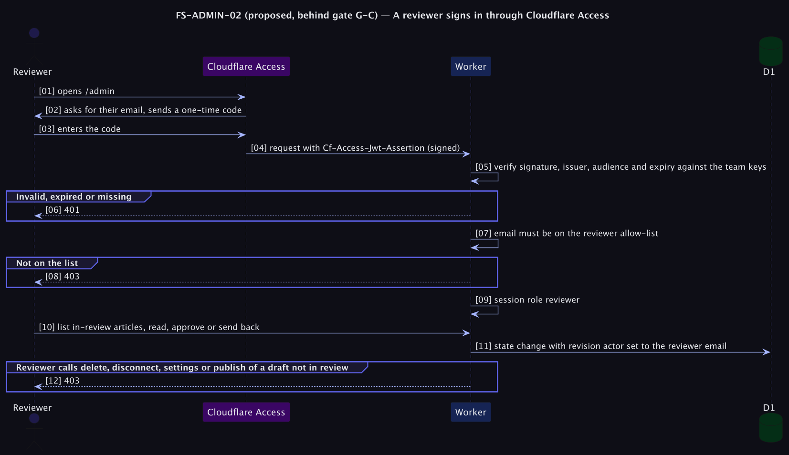

# FS-ADMIN-02 — A reviewer signs in through Cloudflare Access

**Status: Proposed (behind roadmap gate G-C; do not build until a reviewer exists).** For open question Q6: who reads Khmer drafts besides the owner? ([PRD](../../../../tomlop-mobile-android/docs/product/prd-content-platform.md)). Decision: [ADR 0013](../../adr/0013-reviewer-access-via-cloudflare-access.md).

## Table of Contents
1. [Meta](#1-meta-information) · 2. [Description](#2-description--use-case) · 3. [Pre/Post-conditions](#3-pre-conditions--post-conditions) · 4. [Contracts](#4-contracts) · 5. [Controls & States](#5-controls--states) · 6. [UI](#6-ui-flow--screen-wireframes) · 7. [Email](#7-email-templates) · 8. [Sequence](#8-technical-sequence-flows) · 9. [Security & Operations](#9-security--operational-controls) · 10. [Changes](#10-change-history) · 11. [Sign-off](#11-business-owner-sign-off)

## 1. Meta Information
| Field | Value |
|---|---|
| Flow ID | `FS-ADMIN-02` |
| Subdomain | Identity & Access |
| Status | Proposed (behind roadmap gate G-C; do not build until a reviewer exists) |
| Version | 0.1.0 |
| Created | 2026-10-26 |
| Author | Chamrong, with Claude |

## 2. Description & Use Case
### 2.1 Business & UX Overview
A trusted Khmer reader can be invited to review drafts without being given the owner's password. They sign in with their own email and a one-time code (handled by Cloudflare Access), see the review queue, read drafts and approve or send them back. They **cannot** delete, disconnect apps, change settings, or publish a draft nobody asked them to review.

### 2.2 Technical System Logic
Cloudflare Access protects `/admin*` and `/api/admin*`. Access adds a signed JWT in `Cf-Access-Jwt-Assertion`; the Worker **verifies it itself** (signature against the team's published keys, issuer, audience for this application, expiry) and takes the email from the verified claims, never from a plain header. An allow-list `NUXT_REVIEWER_EMAILS` maps emails to the `reviewer` role; the owner remains the password-and-session admin. Role is a field on the session/identity object and checked in the route guard. This avoids adding password storage, reset or MFA code to the app.

## 3. Pre-conditions & Post-conditions
| Pre-conditions | Post-conditions |
|---|---|
| Cloudflare Access is configured with a policy for the reviewer's email | The reviewer has a `reviewer` identity for the request |
| `NUXT_REVIEWER_EMAILS` lists them | Their actions are recorded with their email |

## 4. Contracts
| Item | Contract |
|---|---|
| Identity | Verified `Cf-Access-Jwt-Assertion`; reject on any failure (401) |
| Allowed | List and read drafts and in-review articles; approve (publish) or send back **only articles in `in_review`**; read revisions |
| Denied (403) | Create, edit body, delete, retire, connections, OAuth consent, settings, publish of a draft not in review |
| Audit | Revision `actor` = reviewer email, `actor_kind = reviewer` |

## 5. Controls & States
| Item | Rule |
|---|---|
| Keys | Fetched from the team domain's certs endpoint and cached briefly; a failure to verify denies |
| Bypass | The owner's password route remains for the owner, and also passes through Access if Access fronts the whole path |
| Scope creep | Adding any capability to the reviewer needs this spec updated |
| Removal | Delete the email from the secret and from the Access policy; sessions end with the Access session |

## 6. UI Flow & Screen Wireframes
The reviewer sees the same dashboard reduced to *Waiting for review* and the review screen; owner-only controls are not rendered (and are refused by the server if forced).

## 7. Email Templates
Not applicable.

## 8. Technical Sequence Flows

## 9. Security & Operational Controls
| Control | Note |
|---|---|
| JWT verification in the Worker, not only at the edge | If Access is mis-scoped the Worker still refuses |
| Allow-list plus role checks per route | Server-enforced |
| No new secrets of ours | Access holds the identity |
| MFA | Provided by the Access identity provider options (verify what the free plan includes) |
Residual risk: an error in the verification code would let a forged header pass; it needs a dedicated test with tampered and expired tokens.

## 10. Change History
| Version | Date | Change |
|---|---|---|
| 0.1.0 | 2026-10-26 | First draft |

## 11. Business Owner Sign-off
### 11.1 Decisions proposed
**D1** Identity from Access, not our own password system. **D2** Reviewer is read-and-approve only.
### 11.2 Approvals
Blocked by gate G-C: only if the cadence or review load is shown to exceed what the owner can do.
### 11.3 Constraints
**C1** Free-plan limits of Cloudflare Access (verify). **C2** Depends on FS-CONTENT-04.
### 11.4 Out of scope
**O1** Multiple authors with write access. **O2** Public sign-up.
### 11.5 Test cases
| ID | Case | Layer |
|---|---|---|
| T1 | A request without a valid Access token is refused | Unit |
| T2 | A tampered, expired, or wrong-audience token is refused | Unit |
| T3 | A reviewer can approve an in-review article and cannot delete or publish a draft not in review | e2e |
| T4 | The revision records the reviewer email and `actor_kind = reviewer` | e2e |
| T5 | Removing the email revokes access on the next request | e2e |
