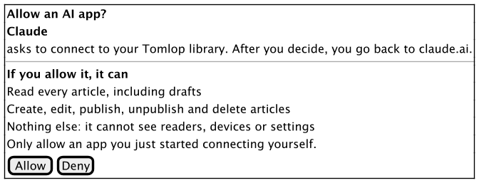
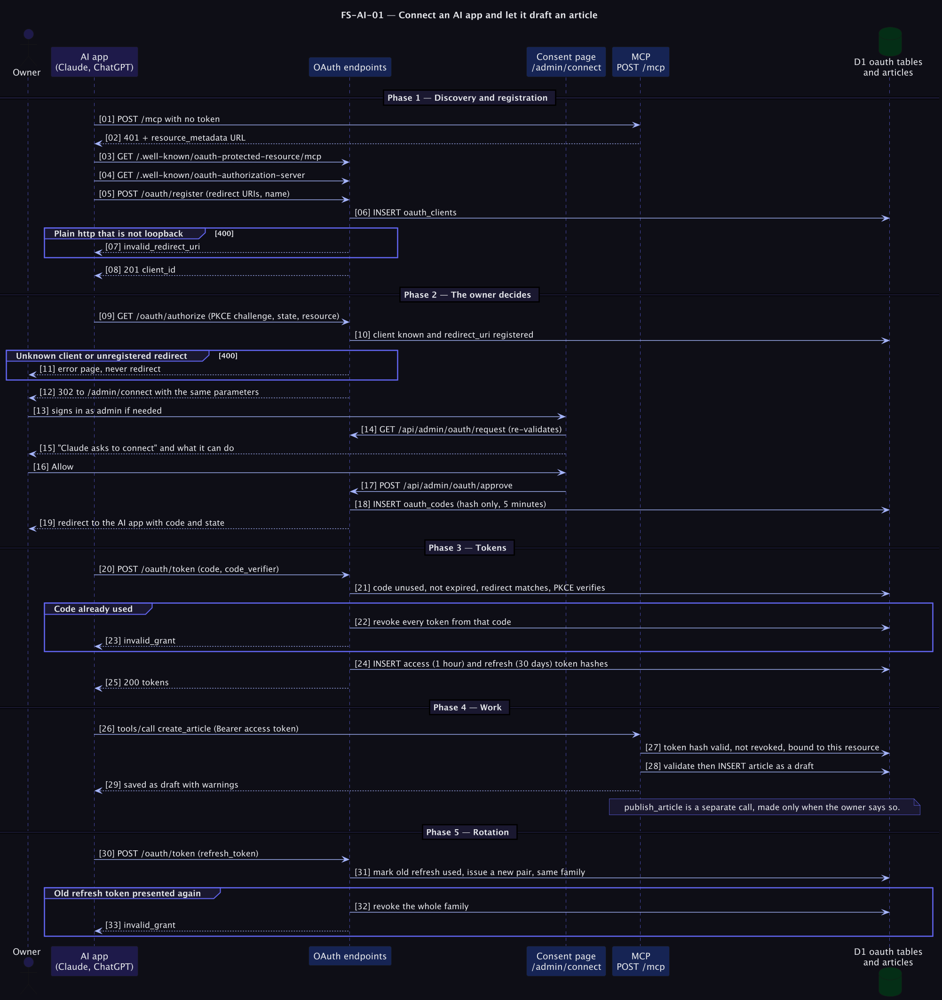

# FS-AI-01 — Connect an AI app and let it draft an article

## Table of Contents
1. [Meta](#1-meta-information) · 2. [Description](#2-description--use-case) · 3. [Pre/Post-conditions](#3-pre-conditions--post-conditions) · 4. [Contracts](#4-rest-api-endpoint-contracts) · 5. [Controls & States](#5-controls--states) · 6. [UI](#6-ui-flow--screen-wireframes) · 7. [Email](#7-email-templates) · 8. [Sequence](#8-technical-sequence-flows) · 9. [Security](#9-security--operational-controls) · 10. [Changes](#10-change-history) · 11. [Sign-off](#11-business-owner-sign-off)

## 1. Meta Information
| Field | Value |
|---|---|
| Flow ID | `FS-AI-01` |
| Subdomain | Content & Publishing, AI authoring |
| Status | Approved (as built); *Proposed* items are marked |
| Version | 1.0.0 |
| Created | 2026-10-26 |
| Author | Chamrong, with Claude |

## 2. Description & Use Case
### 2.1 Business & UX Overview
Writing Khmer articles is the slow part of growing the library. The owner connects Claude or ChatGPT once, then asks in plain words for a draft. The assistant reads the article guide, proposes an outline, writes the article, runs the checker, and saves a **draft**. The owner reads it in the backoffice and publishes it, or asks the assistant to change it `→ [D1]`.
The owner can see every connected app and cut any of them off immediately `→ [D2]`.

### 2.2 Technical System Logic
[ADR 0004](../../adr/0004-ai-authoring-through-mcp-with-oauth.md) · [MCP.md](../../MCP.md) · [ERD](../../erd/erd_content.md) (`oauth_*` tables) · code: `server/lib/oauth.ts`, `server/lib/mcp/`, `server/routes/mcp.ts`, `server/routes/oauth/`.

## 3. Pre-conditions & Post-conditions
| Pre-conditions | Post-conditions |
|---|---|
| Admin secrets are configured | A registered client, and after Allow an access token (1 h) and a rotating refresh token (30 days), stored as hashes |
| The owner can sign in as admin | Tool calls create or change articles exactly as the backoffice would |
| The AI app supports remote MCP with OAuth | Disconnecting revokes every token and forgets the client |

## 4. REST API Endpoint Contracts
| Endpoint | Purpose | Notes |
|---|---|---|
| `GET /.well-known/oauth-protected-resource` and `/mcp` | RFC 9728 metadata | `resource` is `<site>/mcp` |
| `GET /.well-known/oauth-authorization-server`, `/openid-configuration` | RFC 8414 metadata | `code_challenge_methods_supported: ["S256"]` |
| `POST /oauth/register` | RFC 7591 registration | HTTPS redirect URIs, or `http://` on loopback only; at most 10 URIs; 20 registrations per hour per address |
| `GET /oauth/authorize` | Start | Validates client, redirect URI, PKCE, scope, resource; redirects to `/admin/connect`; errors about the redirect URI itself are **never** redirected |
| `GET /api/admin/oauth/request` | Consent details | Admin only; re-validates the same parameters |
| `POST /api/admin/oauth/approve` | Allow / Deny | Admin only; returns where to send the browser |
| `POST /oauth/token` | Code and refresh grants | Form or JSON; secrets via Basic or body; 60 per 10 minutes per address |
| `POST /oauth/revoke` | RFC 7009 | Always 200 |
| `POST /mcp` | JSON-RPC 2.0 | `Authorization: Bearer`; `401` with `WWW-Authenticate: Bearer … resource_metadata=…` when missing or invalid; `GET`/`DELETE` give `405` |
| `GET /api/admin/oauth/connections`, `DELETE …/:id` | Manage | Admin only |

### 4.1 MCP tools
| Tool | Effect | Hints |
|---|---|---|
| `get_platform_guide` | Format, limits, style, workflow | read-only |
| `list_articles` | All articles incl. drafts, `suggestedNextId` | read-only |
| `get_article` | One article's Markdown | read-only |
| `check_article` | Validate without saving | read-only |
| `create_article` | New **draft** | not idempotent |
| `update_article` | Replace Markdown; keeps published state | idempotent |
| `publish_article` | Publish or return to draft | idempotent |
| `delete_article` | Remove | **destructive** |
Tool errors are returned as `isError` results with a message the assistant can act on, not as protocol errors.

## 5. Controls & States
| Item | Rule |
|---|---|
| Scope | One scope, `articles`. `offline_access`, `openid`, `profile`, `email` are accepted and ignored |
| Public clients | PKCE (S256) is mandatory. Confidential clients may omit PKCE and must present their secret |
| Codes | Single use, 5 minutes, bound to client and redirect URI; reuse revokes the family |
| Tokens | Access 1 h, refresh 30 days, rotated on every use; reuse of an old refresh token revokes the family |
| Resource binding | Tokens are valid only for `<site>/mcp`; the origin comes from config, not the Host header |
| Connection states | *Connected* (live refresh token), *Signed out* (tokens expired or revoked), *Never allowed* (registered, consent not granted). Unfinished registrations can be cleared in one click |
| *Proposed* | Split scope: connectors may write drafts and request review but not publish or delete ([ADR 0009](../../adr/0009-editorial-states-and-review.md)) |

## 6. UI Flow & Screen Wireframes
Admin → *AI connectors*: server address with Copy, per-app steps (Claude, ChatGPT, Claude Code), connected apps with inline Disconnect. The consent screen names the app, says where the browser returns, and lists what is and is not granted.

## 7. Email Templates
Not applicable.

## 8. Technical Sequence Flows

## 9. Security & Operational Controls
| Control | Where | ASVS 5.0.0 (per quick reference) |
|---|---|---|
| Authorization code + PKCE (S256), exact redirect URI match, no redirect to an unregistered URI | `checkAuthorizeRequest` | 6.8.x (federated/token verification) |
| Codes and tokens stored only as SHA-256 hashes | `oauth.ts` | — |
| Replay detection revokes the whole family | `exchangeCode`, `refreshTokens` | — |
| Consent behind the admin session; the connector cannot approve itself | `/admin/connect`, `approve.post.ts` | — |
| Registration, token and sign-in endpoints rate-limited in D1 | `rateLimit` | 6.3.1 |
| Tools validate input with the same validator as the backoffice; ids cannot traverse paths | `tools.ts` | — |
| Destructive tool is annotated so apps ask before calling it | `tools.ts` | — |

**Residual risks (see the risk register):** a model can publish or delete if the owner approves the tool call; a model can write fluent but wrong Khmer; a malicious page in the same chat could try to steer the model (prompt injection) into calling tools. The mitigations are human review, drafts by default, the review-state proposal, and disconnecting an app you no longer use.
IDs come from the flow-doc quick reference; confirm against ASVS 5.0.0 before any formal audit.

## 10. Change History
| Version | Date | Change |
|---|---|---|
| 1.0.0 | 2026-10-26 | First spec, written from the built behaviour |

## 11. Business Owner Sign-off
### 11.1 Decisions
**D1** Create always yields a draft; publishing is a separate act. · **D2** The owner can disconnect any app instantly. · **D3** OAuth 2.1 with dynamic registration, because Claude and ChatGPT require it.
### 11.2 Approvals
Pending owner review. Not yet exercised against a live Claude or ChatGPT connector on production; the local flow is tested.
### 11.3 Technical constraints
**C1** Streamable HTTP, stateless; no server-to-client streaming. · **C2** The connector origin must be exactly the canonical URL.
### 11.4 Out of scope
**O1** Per-tool permissions. · **O2** Reading reader data (there is none). · **O3** Image upload through MCP.
### 11.5 Test cases
| ID | Case | Covered by |
|---|---|---|
| T1 | 401 with resource metadata when no token | `e2e-local.py` |
| T2 | Registration refuses plain-http non-loopback redirect URIs | `e2e-local.py` |
| T3 | Authorize with an unregistered redirect URI is an error page, not a redirect | `e2e-local.py` |
| T4 | Public client without PKCE is refused via error redirect | `e2e-local.py` |
| T5 | Approve without an admin session is 401; deny returns `access_denied` | `e2e-local.py` |
| T6 | Wrong PKCE verifier rejected; replayed code rejected and revokes its tokens | `e2e-local.py` |
| T7 | All eight tools work; bad ids and unknown tools return `isError` | `e2e-local.py` |
| T8 | Refresh rotates; reuse of an old refresh token revokes the family | `e2e-local.py` |
| T9 | Disconnect kills tokens immediately | `e2e-local.py` |
| T10 | A real Claude and a real ChatGPT connector against production | **Not yet done** |
