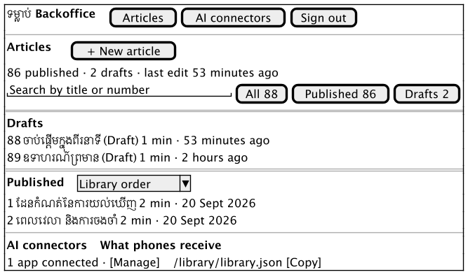
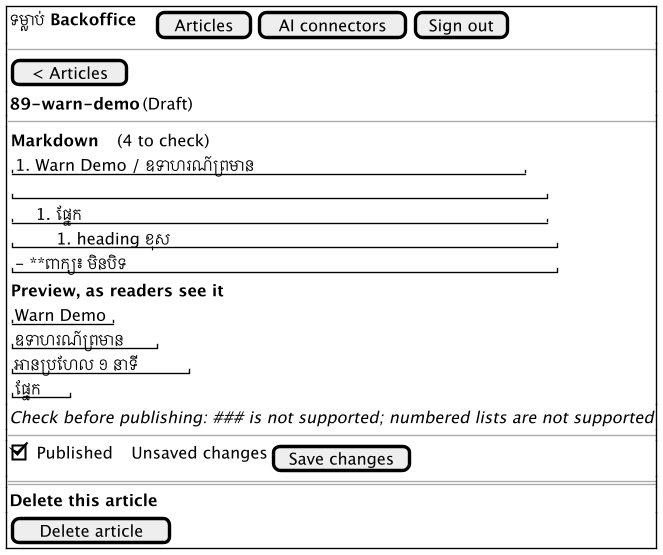
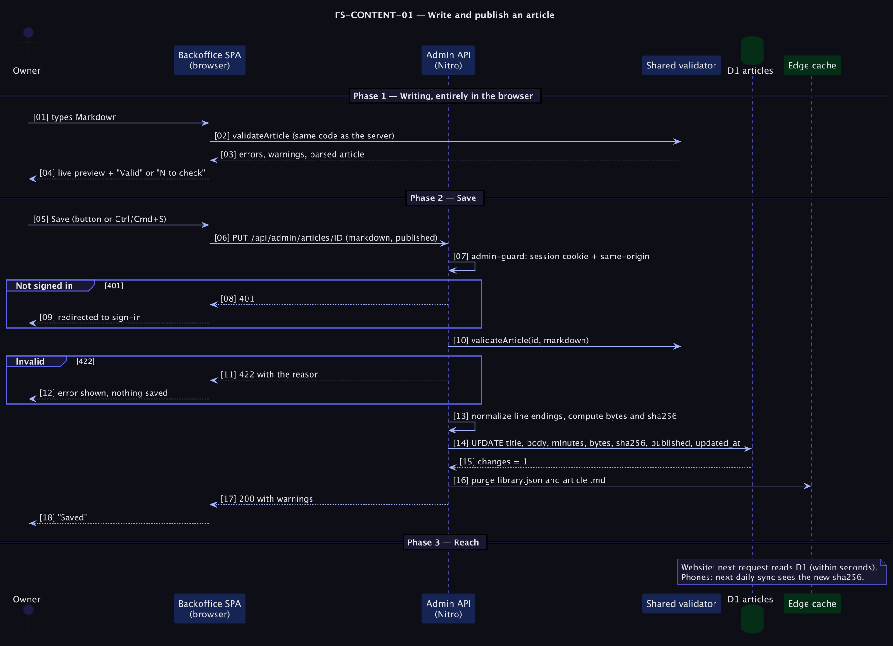

# FS-CONTENT-01 — Write and publish an article

## Table of Contents
1. [Meta Information](#1-meta-information)
2. [Description & Use Case](#2-description--use-case)
3. [Pre-conditions & Post-conditions](#3-pre-conditions--post-conditions)
4. [REST API Endpoint Contracts](#4-rest-api-endpoint-contracts)
5. [Controls & States](#5-controls--states)
6. [UI Flow & Screen Wireframes](#6-ui-flow--screen-wireframes)
7. [Email Templates](#7-email-templates)
8. [Technical Sequence Flows](#8-technical-sequence-flows)
9. [Security & Operational Controls](#9-security--operational-controls)
10. [Change History](#10-change-history)
11. [Business Owner Sign-off](#11-business-owner-sign-off)

## 1. Meta Information
| Field | Value |
|---|---|
| Flow ID | `FS-CONTENT-01` |
| Subdomain | Content & Publishing |
| Status | Approved (as built); items marked *Proposed* are not built |
| Version | 1.0.0 |
| Created | 2026-10-26 |
| Author | Chamrong, with Claude |

## 2. Description & Use Case
### 2.1 Business & UX Overview
The owner writes a Khmer article, sees exactly how readers will see it while typing, fixes any format problems the checker reports, and publishes with one switch.
The same article then reaches the website within minutes and phones on their next daily check ([FS-CONTENT-02](fs_content_02_feed_sync.md)).

What makes it usable, not just possible:
- **Live preview** uses the public page's own component, so the preview cannot drift from what is published `→ [D1]`.
- **Live checks** run the very validator the server runs, so "Valid" in the editor means saving will succeed `→ [D2]`.
- **Dashboard** puts drafts first, supports search and filters over 86+ articles, and shows when things last changed `→ [D3]`.
- **Safe destructive actions**: deleting needs an inline confirmation that says what it does and does not remove; leaving with unsaved changes asks first `→ [D4]`.

### 2.2 Technical System Logic
Data model: [ERD](../../erd/erd_content.md) · Architecture: [C4](../../c4/c4_tomlop.md) · Decisions: [ADR 0005](../../adr/0005-one-article-format-one-validator.md), [ADR 0006](../../adr/0006-edge-cache-with-ttl-and-purge.md).
Saving recomputes `title_en`, `title_km`, `reading_minutes`, `bytes` and `sha256` from the Markdown, so the feed can never disagree with the file.

## 3. Pre-conditions & Post-conditions
| Pre-conditions | Post-conditions |
|---|---|
| The admin is signed in ([FS-ADMIN-01](../admin/fs_admin_01_sign_in.md)) | The article row exists with metadata derived from its body |
| The id is unused (create) or exists (update) | If published: appears in `library.json` and `/read/` |
| The body is valid per the format | The feed index and this article's cache entries are purged in the nearest data centre |
| | If it is a draft: invisible to readers, the feed and phones |

## 4. REST API Endpoint Contracts
All `/api/admin/*` routes need the session cookie and, for non-GET requests, a same-origin `Origin` header. Errors use the shape `{ statusCode, statusMessage, message }`.

### 4.1 `GET /api/admin/articles`
`200` → `{ suggestedNextId: string, articles: [{ id, titleEn, titleKm, readingMinutes, published, updatedAt }] }` in library order (`CAST(id AS INTEGER), id`). Includes drafts.

### 4.2 `GET /api/admin/articles/:id`
`200` → `{ id, markdown, published, readingMinutes, updatedAt }` · `404` unknown id.

### 4.3 `POST /api/admin/articles`
Body `{ id, markdown, published }` (`published` defaults to `false`).
`200` → `{ ok: true, warnings: string[] }` · `400` malformed body · `422` the id is invalid or taken, the heading is missing, the body is empty or over 100 KB.

### 4.4 `PUT /api/admin/articles/:id`
Body `{ markdown, published }`. `200` as above · `422` validation, or "No article with id" if it does not exist.

### 4.5 `DELETE /api/admin/articles/:id`
`200` → `{ ok: true }` · `404` unknown id. Removes the row; phones keep any copy they downloaded and the bundled 86 stay in the app.

### 4.6 Public read APIs used by the website
`GET /api/read` → published list. `GET /api/read/:id` → parsed article with `prev` and `next`; `404` for drafts and unknown ids.

## 5. Controls & States
| Item | Rule |
|---|---|
| Article state | `draft` (published = 0) or `published` (1). *Proposed:* `in_review` ([ADR 0009](../../adr/0009-editorial-states-and-review.md)) |
| Id | `^\d{2,3}-[a-z0-9]+(-[a-z0-9]+)*$`; permanent; sets order and is the filename on phones |
| Size | At most 100,000 bytes after normalising line endings (the app refuses downloads over 256 KB) |
| Format | `# English / ខ្មែរ`, intro lines, `## sections` of plain lines and `- bullets`, `**bold**` only; anything else is a **warning**, shown live and on save |
| Editor states | clean, dirty ("Unsaved changes"), saving, saved, error; Save is disabled while saving, when the id is invalid, or when the checker reports an error |
| Navigation | Ctrl/Cmd+S saves; leaving with unsaved changes asks; the browser's tab-close prompt also fires |
| Cache | Feed and article URLs cached 300 s, purged on every write |
| List | Default view shows Drafts then Published; searching or filtering shows one flat Results list with a status chip per row |

## 6. UI Flow & Screen Wireframes
Dashboard → *New article* or a row → editor (Write and Preview side by side on wide screens; a Write / Preview switch on phones) → Save → back to the list.
The screens below are structural sketches; the shipped UI uses the site's design tokens (paper, green, saffron).

**Dashboard**

**Editor**

Empty and error states: no drafts ("No drafts waiting" with two next actions); no search results ("Nothing matches" with *Clear search*); load failure (error notice with *Try again*); loading (skeleton rows, not a spinner).

## 7. Email Templates
Not applicable. This flow sends no email.

## 8. Technical Sequence Flows

## 9. Security & Operational Controls
| Control | Where | ASVS 5.0.0 (per the flow-doc quick reference) |
|---|---|---|
| Session required on every admin call; the SPA redirect is only a convenience | `server/middleware/admin-guard.ts` | 3.3.x (session handling) |
| Same-origin check on state-changing requests, plus `SameSite=Lax` | `assertSameOrigin` | 3.5.1 |
| All article text is escaped by Vue; only `**bold**` becomes `<strong>` via real elements, never `v-html` | `InlineText.vue`, `splitBold` | — (output encoding) |
| Size and id limits before any write | `validateArticle` | — (input validation) |
| Cache purge after writes so a takedown is quick | `purgeArticleCaches` | — |

Operational: after a bad publish, unpublish at once (feed purge is immediate in the nearest region, within 5 minutes elsewhere). Phones that already synced keep the text until a corrected version replaces it. A revision history to restore the previous text is **proposed** ([ADR 0008](../../adr/0008-article-revision-history.md)).
IDs in the ASVS column come from the flow-doc quick reference; re-check them against the ASVS 5.0.0 text before any formal audit.

## 10. Change History
| Version | Date | Change |
|---|---|---|
| 1.0.0 | 2026-10-26 | First spec, written from the built behaviour |

## 11. Business Owner Sign-off
### 11.1 Decisions
- **D1** Preview renders the public component. · **D2** One validator for server and browser. · **D3** Drafts first on the dashboard. · **D4** Inline confirmation, not modal dialogs, for destructive actions.
- **D5** Publishing is a toggle on the article, not a separate screen.

### 11.2 Approvals
Pending owner review of this document.

### 11.3 Technical constraints
- **C1** D1 free tier: 100,000 row writes and 5,000,000 row reads per day. · **C2** The article format must stay identical to the app's parser ([ADR 0005](../../adr/0005-one-article-format-one-validator.md)).

### 11.4 Out of scope
- **O1** Images, links, tables or headings below `##` in articles. · **O2** Scheduled publishing. · **O3** Multiple authors and roles ([ADR 0003](../../adr/0003-single-admin-sealed-session.md)). · **O4** Revision history and review states (proposed, see ADRs 0008 and 0009).

### 11.5 Test cases
| ID | Case | Covered by |
|---|---|---|
| T1 | All 86 bundled articles parse and validate with no warnings | `server/lib/markdown.test.ts` |
| T2 | Bad id, missing heading, empty body, duplicate id are rejected | `markdown.test.ts`, `scripts/e2e-local.py` |
| T3 | Warnings for `###`, numbered lists, `*` bullets, quotes, links, HTML, unbalanced `**` | `markdown.test.ts` |
| T4 | A draft is absent from the feed, the markdown URL and `/read`; publishing makes it appear at once | `e2e-local.py` |
| T5 | The markdown served hashes to the `sha256` in the feed | `e2e-local.py` |
| T6 | Bold renders as `<strong>` with no literal `**` on the page | `e2e-local.py`, `inline.test.ts` |
| T7 | Unsaved-changes guard, Ctrl/Cmd+S, inline delete confirmation | **Not automated yet** (manual); see testing notes |
