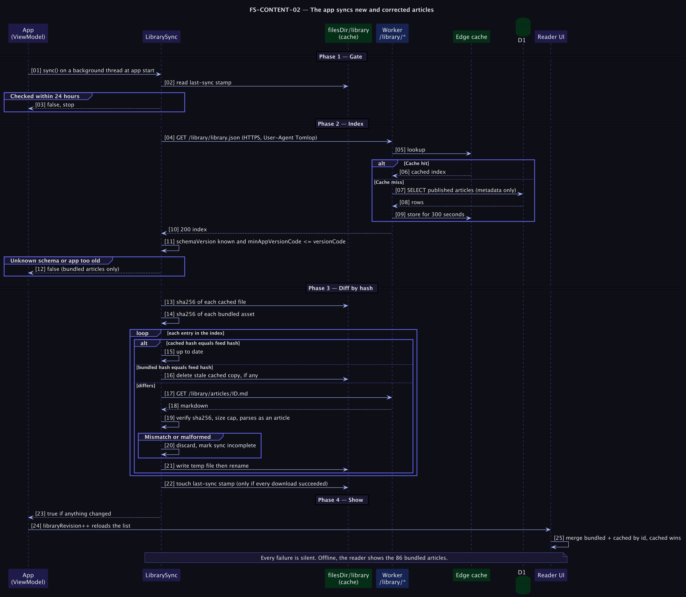

# FS-CONTENT-02 — The app syncs new and corrected articles

## Table of Contents
1. [Meta](#1-meta-information) · 2. [Description](#2-description--use-case) · 3. [Pre/Post-conditions](#3-pre-conditions--post-conditions) · 4. [Contracts](#4-rest-api-endpoint-contracts) · 5. [Controls & States](#5-controls--states) · 6. [UI](#6-ui-flow--screen-wireframes) · 7. [Email](#7-email-templates) · 8. [Sequence](#8-technical-sequence-flows) · 9. [Security](#9-security--operational-controls) · 10. [Changes](#10-change-history) · 11. [Sign-off](#11-business-owner-sign-off)

## 1. Meta Information
| Field | Value |
|---|---|
| Flow ID | `FS-CONTENT-02` |
| Subdomain | Content & Publishing, Android client |
| Status | Approved (as built); ships to users with app versionCode 2 |
| Version | 1.0.0 |
| Created | 2026-10-26 |
| Author | Chamrong, with Claude |

## 2. Description & Use Case
### 2.1 Business & UX Overview
A reader opens the app. In the background, once a day at most, it checks for new or corrected articles and quietly adds them to the library. The reader never waits, never sees an error, and never loses the 86 articles that came with the app.
Offline, nothing changes. This is the promise that justifies the single network permission the app now holds `→ [D1]`.

### 2.2 Technical System Logic
Contract and rationale: [feed-schema.md](../../feed-schema.md), [ADR 0002](../../adr/0002-feed-is-a-contract-with-a-bundled-floor.md). Client: `LibraryFeed.kt` (pure rules, unit-tested) and `LibrarySync.kt` in the app repo. Server: `server/routes/library/*`.

## 3. Pre-conditions & Post-conditions
| Pre-conditions | Post-conditions |
|---|---|
| App build has `versionCode >= minAppVersionCode` (2) | New or changed published articles are in `filesDir/library/` |
| Last successful sync was more than 24 h ago | A stale cached copy is deleted when the feed reverts to the bundled text |
| The device has a connection | `last-sync` is touched only if every download succeeded, otherwise the next launch retries |

## 4. REST API Endpoint Contracts
### 4.1 `GET /library/library.json`
`200`, `application/json`, cached 300 s:
```json
{ "schemaVersion": 1, "generatedAt": "2026-10-26T05:40:00Z", "minAppVersionCode": 2,
  "articles": [ { "id": "01-perception-limits", "path": "articles/01-perception-limits.md",
                  "titleEn": "…", "titleKm": "…", "readingMinutes": 2, "bytes": 2824, "sha256": "…64 hex…" } ] }
```
Only published articles, in library order. `generatedAt` is the newest edit, so an unchanged feed is byte-identical.

### 4.2 `GET /library/articles/:id.md`
`200`, `text/markdown`, body is exactly the bytes the `sha256` covers, with an `ETag` of that hash · `404` for drafts and unknown ids.

### 4.3 Client rules (normative)
1. Never block the UI; run on a background thread; every failure is silent.
2. Ignore the feed when `schemaVersion` is not 1 or `minAppVersionCode` exceeds the build.
3. Accept only entries whose `id` matches `^\d{2,3}-[a-z0-9]+(-[a-z0-9]+)*$`, whose `path` matches `^articles/[a-z0-9-]+\.md$`, and whose `sha256` is 64 hex characters; at most 1,000 entries.
4. Skip an entry when the cached or bundled hash already equals the feed hash; delete a stale cached copy when the *bundled* hash matches.
5. Download with a 10 s connect and 15 s read timeout, HTTPS only, at most 512 KB for the index and 256 KB per article, `User-Agent: Tomlop`.
6. Verify the hash **and** that the text parses as an article before writing; write to a temporary file then rename.
7. At load time merge bundled and cached by id; **the cached copy wins**.

## 5. Controls & States
| Item | Rule |
|---|---|
| Frequency | At most once per 24 h after a fully successful sync; otherwise at the next app start |
| Retraction | Unpublish/delete removes an article from the feed; phones keep what they have `→ [O2]` |
| Backups | The cache folder is excluded from Android cloud backup (`backup_rules.xml`, `data_extraction_rules.xml`) |
| Data used | A few KB a day for the index; a new or corrected article costs its own size (about 3 KB). Articles that already match the bundled text are never downloaded |

## 6. UI Flow & Screen Wireframes
No dedicated screen. The only visible effect is the reading list gaining an article or an updated article after a sync. (Proposed, no spec yet: a quiet "N new articles" marker on the library entry.)

## 7. Email Templates
Not applicable.

## 8. Technical Sequence Flows


## 9. Security & Operational Controls
| Control | Where |
|---|---|
| HTTPS only; `httpGet` refuses any other scheme; cleartext is blocked by default on this target SDK | `LibrarySync.kt` |
| Ids and paths validated by strict patterns because they become filenames (blocks path traversal) | `LibraryFeed.kt` |
| Integrity: SHA-256 per article from the index, verified before writing | `LibrarySync.kt` |
| Size and time limits on every download | `httpGet` |
| The phone sends no identifier, habit, goal or setting data; the server sees an IP address as any web server does | Privacy policy §2 |
| Edge cache with purge on write | [ADR 0006](../../adr/0006-edge-cache-with-ttl-and-purge.md) |

Integrity here protects against corruption and a mismatched cache, not against a compromised server: the index and the hashes come from the same origin over TLS. Signing the index is not planned; the blast radius is limited to article text the app renders as plain text.

## 10. Change History
| Version | Date | Change |
|---|---|---|
| 1.0.0 | 2026-10-26 | First spec, written from the built behaviour |

## 11. Business Owner Sign-off
### 11.1 Decisions
**D1** The sync is the only network use in the app. · **D2** Cached beats bundled, so corrections ship without a release. · **D3** Hash comparison, never presence.
### 11.2 Approvals
Pending owner review. Pending: Play Data safety answers ([play-listing.md](../../../../tomlop-mobile-android/docs/play-listing.md)).
### 11.3 Technical constraints
**C1** Bundled articles can never be removed by the feed. · **C2** The app must stay fully usable offline forever.
### 11.4 Out of scope
**O1** Push notifications for new articles. · **O2** Remote retraction of an article already on phones (see roadmap). · **O3** A user-facing "update now" button.
### 11.5 Test cases
| ID | Case | Covered by |
|---|---|---|
| T1 | Downloads a new article and verifies its hash | `LibrarySyncTest` |
| T2 | Rejects a download whose hash differs; the next launch may retry | `LibrarySyncTest` |
| T3 | Picks up a correction to an article it already has | `LibrarySyncTest` |
| T4 | Does not download what the bundled copy already matches; drops a stale cache when the feed reverts | `LibrarySyncTest` |
| T5 | Stays quiet for 24 h after a full success | `LibrarySyncTest` |
| T6 | Ignores a feed that is too new, of an unknown schema, offline, or garbage | `LibrarySyncTest` |
| T7 | Refuses ids and paths that could escape the cache folder | `LibrarySyncTest` |
| T8 | Cached article replaces the bundled one with the same id | `LibrarySyncTest` |
| T9 | Feed hashes equal the served bytes' hashes | `scripts/e2e-local.py` |
| T10 | On a real device with a real server (airplane mode on/off, captive portal, slow link) | **Not yet done**; see the app repo's research plan |
