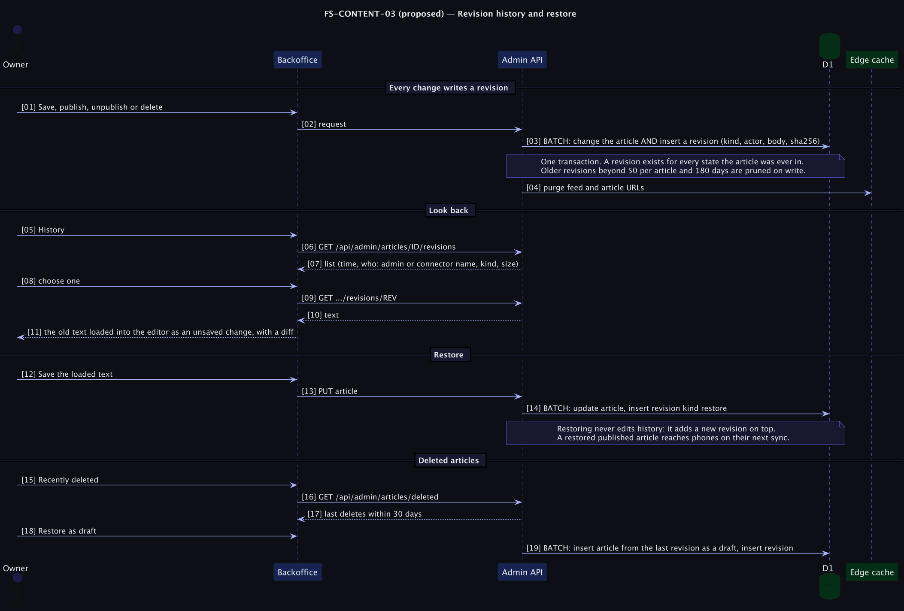

# FS-CONTENT-03 — Revision history and restore

**Status: Proposed (priority P1; the first thing to build on the platform).** Fixes [PRD problem C2](../../../../tomlop-mobile-android/docs/product/prd-content-platform.md): a wrong edit to a published article reaches every phone and cannot be undone. Decision: [ADR 0008](../../adr/0008-article-revision-history.md).

## Table of Contents
1. [Meta](#1-meta-information) · 2. [Description](#2-description--use-case) · 3. [Pre/Post-conditions](#3-pre-conditions--post-conditions) · 4. [Contracts](#4-contracts) · 5. [Controls & States](#5-controls--states) · 6. [UI](#6-ui-flow--screen-wireframes) · 7. [Email](#7-email-templates) · 8. [Sequence](#8-technical-sequence-flows) · 9. [Security & Operations](#9-security--operational-controls) · 10. [Changes](#10-change-history) · 11. [Sign-off](#11-business-owner-sign-off)

## 1. Meta Information
| Field | Value |
|---|---|
| Flow ID | `FS-CONTENT-03` |
| Subdomain | Content & Publishing |
| Status | Proposed (priority P1; the first thing to build on the platform) |
| Version | 0.1.0 |
| Created | 2026-10-26 |
| Author | Chamrong, with Claude |

## 2. Description & Use Case
### 2.1 Business & UX Overview
Every change to an article is remembered, with who made it and when, and any earlier version can be brought back. This is what makes it safe to let an AI assistant edit articles and safe for the owner to be bold: nothing is ever lost, even a deletion.
- **History** per article: time, who (the admin, or the name of the connected app), what kind of change, size.
- **Compare and restore:** choose a version, see it next to the current text, load it into the editor, then Save. Restoring *adds* a revision; it never rewrites history.
- **Recently deleted:** deleted articles can be brought back as drafts for 30 days.

### 2.2 Technical System Logic
New table `article_revisions` (migration `0004`; see [ERD](../../erd/erd_content.md)): `id INTEGER PK AUTOINCREMENT`, `article_id TEXT`, `kind TEXT` (`create | update | publish | unpublish | delete | restore | retire`), `body TEXT`, `sha256 TEXT`, `published INTEGER`, `actor TEXT`, `actor_kind TEXT` (`admin | connector`), `created_at TEXT`. Index on `(article_id, id)`.
Every write path (`saveArticle`, `setPublished`, `deleteArticle`, and the review transitions of FS-CONTENT-04) becomes a **single D1 batch** of the change plus the revision insert, so they succeed or fail together. The actor is the admin session email or the MCP client's name, passed in explicitly (never read from request input).
Pruning happens in the same write: keep the newest 50 revisions per article and everything younger than 180 days; delete the rest. Deleted articles keep their revisions for 30 days and are then pruned.

## 3. Pre-conditions & Post-conditions
| Pre-conditions | Post-conditions |
|---|---|
| An admin session or a connector token | A revision exists for the change |
| The article exists (or was deleted within 30 days) | Restoring leaves the full history intact plus one new revision |

## 4. Contracts
Admin only (session + same-origin):
| Endpoint | Returns |
|---|---|
| `GET /api/admin/articles/:id/revisions` | `[{ id, kind, actor, actorKind, createdAt, bytes, published }]`, newest first, at most 50 |
| `GET /api/admin/articles/:id/revisions/:rev` | `{ id, kind, body, published, createdAt, actor }` |
| `GET /api/admin/articles/deleted` | Articles deleted within 30 days: `{ id, titleKm, titleEn, deletedAt, actor }` |
| `POST /api/admin/articles/restore-deleted` `{ id }` | Re-creates the article as a **draft** from its last revision; `422` if the id exists |
There is no special restore endpoint for live articles: the editor loads a revision and saves it through the normal `PUT`, which writes a `restore` revision when the text equals an earlier revision's hash. MCP gains read-only `list_revisions` and `get_revision`; restoring over MCP is left to the human.

## 5. Controls & States
| Item | Rule |
|---|---|
| Atomicity | Change and revision in one batch; a failure leaves neither |
| Identity | `actor_kind` is `connector` for MCP, with the client name sanitised as today |
| Size | Bodies are at most 100 KB; at 50 revisions of a typical 3 KB article, storage is negligible |
| Retention | 50 per article or 180 days, whichever keeps more; pruned on write, no scheduler needed |
| Deleted | Recoverable for 30 days from the last revision, as a draft, never silently published |
| No-op saves | If the new body hash equals the current one and the state is unchanged, no revision is written |
| Privacy | Revisions contain only article text and an admin email or app name; no reader data exists to leak |

## 6. UI Flow & Screen Wireframes
Editor header: a *History* button opening a panel listing versions. Choosing one loads it into the editor (unsaved, with the live preview and the dirty guard), with a *Compare with current* toggle (line diff). Dashboard: a collapsed *Recently deleted* section appears only when something is recoverable.

## 7. Email Templates
Not applicable.

## 8. Technical Sequence Flows

## 9. Security & Operational Controls
| Control | Note |
|---|---|
| Admin endpoints only; connectors can read but not restore | Scope discipline (FS-CONTENT-04) |
| Same-origin and session checks as every admin route | FS-ADMIN-01 |
| Revision actor is server-assigned | Prevents spoofing in history |
| Retention bounded | Avoids unbounded growth against the D1 free tier |

## 10. Change History
| Version | Date | Change |
|---|---|---|
| 0.1.0 | 2026-10-26 | First draft |

## 11. Business Owner Sign-off
### 11.1 Decisions proposed
**D1** Append-only history written in the same transaction. **D2** Restore through the editor, not a one-click overwrite. **D3** Opportunistic pruning, no cron.
### 11.2 Approvals
Pending owner confirmation of ADR 0008; the retention numbers are proposals.
### 11.3 Constraints
**C1** D1 batch atomicity is the integrity guarantee. **C2** Additive migration only.
### 11.4 Out of scope
**O1** Per-line blame. **O2** Reverting several articles at once. **O3** Restoring over MCP.
### 11.5 Test cases
| ID | Case | Layer |
|---|---|---|
| T1 | Create, update, publish, unpublish, delete each write exactly one revision with the right kind and actor | Unit with a SQLite-backed D1 shim |
| T2 | A failure inserting the revision rolls back the article change | Unit |
| T3 | Restore through the editor adds a revision and leaves old ones untouched | e2e |
| T4 | Pruning keeps the newest 50 and anything under 180 days | Unit |
| T5 | Deleting then restoring-deleted yields a draft with the last text | e2e |
| T6 | An unchanged save writes no revision | Unit |
| T7 | Connector edits record `actor_kind = connector` and the app name | e2e |
