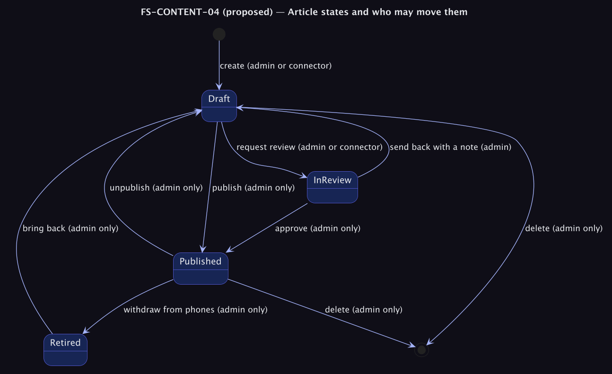
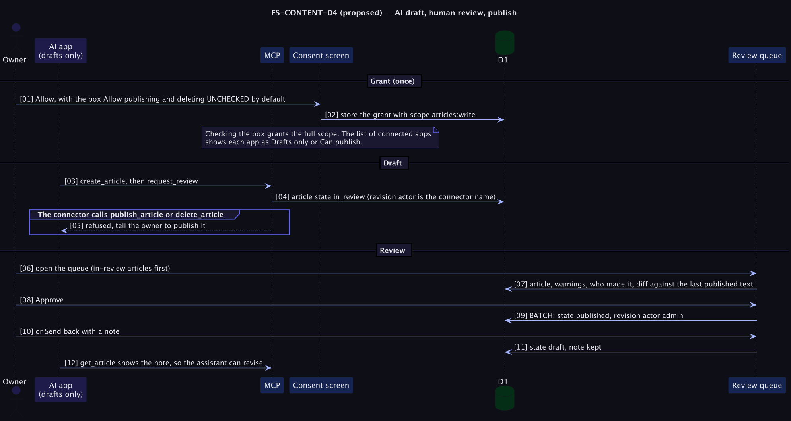

# FS-CONTENT-04 — Review and publish: AI drafts wait for a human

**Status: Proposed (priority P1, after revisions).** Turns 'a human read it' from a convention into a mechanism ([PRD problem C3](../../../../tomlop-mobile-android/docs/product/prd-content-platform.md), risks R-07 and R-08). Decision: [ADR 0009](../../adr/0009-editorial-states-and-review.md).

## Table of Contents
1. [Meta](#1-meta-information) · 2. [Description](#2-description--use-case) · 3. [Pre/Post-conditions](#3-pre-conditions--post-conditions) · 4. [Contracts](#4-contracts) · 5. [Controls & States](#5-controls--states) · 6. [UI](#6-ui-flow--screen-wireframes) · 7. [Email](#7-email-templates) · 8. [Sequence](#8-technical-sequence-flows) · 9. [Security & Operations](#9-security--operational-controls) · 10. [Changes](#10-change-history) · 11. [Sign-off](#11-business-owner-sign-off)

## 1. Meta Information
| Field | Value |
|---|---|
| Flow ID | `FS-CONTENT-04` |
| Subdomain | Content & Publishing |
| Status | Proposed (priority P1, after revisions) |
| Version | 0.1.0 |
| Created | 2026-10-26 |
| Author | Chamrong, with Claude |

## 2. Description & Use Case
### 2.1 Business & UX Overview
An AI app can write a draft and ask for review; it cannot publish or delete unless the owner explicitly granted that when connecting it. Drafts the assistant finishes land in a **review queue** where the owner sees the text, the checker's warnings, who wrote it, and a comparison with the last published version, then approves or sends it back with a note the assistant can read and act on.
The default is the safest choice: when connecting an app, **Allow publishing and deleting is unchecked.**

### 2.2 Technical System Logic
States: `draft`, `in_review`, `published`, `retired` (FS-CONTENT-05). Migration `0005`: `articles.state TEXT NOT NULL DEFAULT 'draft'` and `articles.review_note TEXT`. `published` is kept equal to `(state = 'published')` so the feed, sitemap and website queries do not change. Existing rows are backfilled from `published`.
Scopes: `articles:write` (read, create, edit drafts, request review) and `articles` (everything, as today). New authorizations get `articles:write` unless the admin checks the box on the consent screen; existing tokens keep the scope they were issued with, and the connections list labels each app *Drafts only* or *Can publish*. The scope travels with the token (it is already stored) and is checked in each MCP tool.

## 3. Pre-conditions & Post-conditions
| Pre-conditions | Post-conditions |
|---|---|
| A draft exists | `in_review` articles are invisible to readers and the feed |
| The connector holds `articles:write` or `articles` | Only the admin moves an article to `published` |

## 4. Contracts
MCP additions:
| Tool | Scope | Effect |
|---|---|---|
| `request_review` `{ id }` | write | `draft → in_review`; refused if the article is published |
| `list_review_queue` | write | Ids and titles of `in_review` articles, with any `review_note` |
| `publish_article`, `delete_article` | **full** | Refused for `articles:write` with the message "This app can only prepare drafts. Ask the owner to publish." |
| `update_article` | write | Allowed on drafts and in-review articles. On a **published** article it is refused for a write-only app ("Ask the owner to edit published articles."). **Open question Q11:** should a write-only app instead be able to propose a change to a published article as a pending draft copy? Proposed default: refuse, because a pending-copy mechanism is extra state to build and review |
Admin API: `POST /api/admin/articles/:id/review` `{ action: "approve" | "send_back", note? }`; `GET /api/admin/articles?state=in_review`.

## 5. Controls & States
| Item | Rule |
|---|---|
| Transitions | As the state diagram; only the admin session can publish, approve, unpublish, delete or retire |
| Notes | `review_note` is plain text up to 500 characters, shown to the next assistant call; cleared on the next request for review |
| Visibility | `in_review` and `draft` are invisible to `/read`, the feed, the sitemap and RSS |
| Consent | The checkbox defaults to **off**; its label says exactly what it grants |
| Existing apps | Keep working; the owner can disconnect and reconnect narrower |
| Revisions | Every transition writes a revision with its actor (FS-CONTENT-03) |

## 6. UI Flow & Screen Wireframes
Dashboard: a first section **Waiting for review** above Drafts, each row showing who made it and how long it has waited. Review screen: preview, warnings, a diff against the published version, **Approve** and **Send back** (with a note). Consent screen: a single unchecked box "Also allow this app to publish and delete articles".

## 7. Email Templates
Not applicable.

## 8. Technical Sequence Flows

## 9. Security & Operational Controls
| Control | Note |
|---|---|
| Least privilege by default | `articles:write` |
| Server-enforced, not instruction-enforced | The tool refuses; a prompt-injected model cannot publish |
| Consent states what is granted | Consent page |
| Audit | Revisions record the connector name |
Residual risk: a model with `articles:write` can still write misleading text into a draft; the human review is the control. A model with full scope can publish; that is the owner's explicit choice.

## 10. Change History
| Version | Date | Change |
|---|---|---|
| 0.1.0 | 2026-10-26 | First draft |

## 11. Business Owner Sign-off
### 11.1 Decisions proposed
**D1** Narrow scope by default. **D2** Publishing and deleting are admin-only unless granted. **D3** `published` stays a derived mirror of `state` so existing readers are untouched.
### 11.2 Approvals
Pending owner decisions on ADR 0009 and Q11.
### 11.3 Constraints
**C1** Backwards compatible with tokens already issued. **C2** Additive migration.
### 11.4 Out of scope
**O1** A reviewer who is not the owner (FS-ADMIN-02). **O2** Multi-step approvals. **O3** Scheduled publishing.
### 11.5 Test cases
| ID | Case | Layer |
|---|---|---|
| T1 | A `articles:write` token cannot publish or delete (refused with the message) | e2e |
| T2 | `request_review` moves a draft to in_review and it appears in the queue but not on /read, the feed or the sitemap | e2e |
| T3 | Approve publishes; send-back returns to draft with the note visible to `get_article` | e2e |
| T4 | Consent defaults to narrow scope; checking the box issues full scope | e2e |
| T5 | Existing full-scope tokens keep working | e2e |
| T6 | Backfill sets `state = published` exactly where `published = 1` | Migration test |
| T7 | `published` and `state` can never disagree after any transition | Unit property test |
