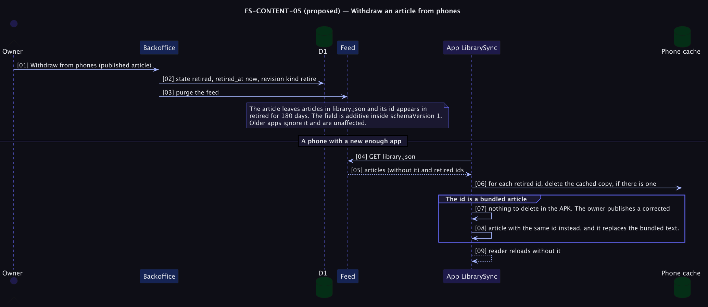

# FS-CONTENT-05 — Withdraw an article from phones

**Status: Proposed (priority P2).** Addresses [PRD problem C5](../../../../tomlop-mobile-android/docs/product/prd-content-platform.md): unpublishing does not remove an article that phones already downloaded. Decision: [ADR 0011](../../adr/0011-additive-feed-evolution-and-retraction.md).

## Table of Contents
1. [Meta](#1-meta-information) · 2. [Description](#2-description--use-case) · 3. [Pre/Post-conditions](#3-pre-conditions--post-conditions) · 4. [Contracts](#4-contracts) · 5. [Controls & States](#5-controls--states) · 6. [UI](#6-ui-flow--screen-wireframes) · 7. [Email](#7-email-templates) · 8. [Sequence](#8-technical-sequence-flows) · 9. [Security & Operations](#9-security--operational-controls) · 10. [Changes](#10-change-history) · 11. [Sign-off](#11-business-owner-sign-off)

## 1. Meta Information
| Field | Value |
|---|---|
| Flow ID | `FS-CONTENT-05` |
| Subdomain | Content & Publishing |
| Status | Proposed (priority P2) |
| Version | 0.1.0 |
| Created | 2026-10-26 |
| Author | Chamrong, with Claude |

## 2. Description & Use Case
### 2.1 Business & UX Overview
If an article is later found wrong, unkind, or harmful, the owner can **withdraw** it: it disappears from the website and the feed, and phones running a new enough app remove their cached copy on the next sync. It cannot remove the 86 originals from the APK; for those, the owner publishes a corrected article with the same id and the corrected text replaces the original on phones.
The honest limit is stated in the backoffice: this removes the article from phones that sync; it cannot reach an offline phone, an old app, or a screenshot.

### 2.2 Technical System Logic
New state `retired` with `retired_at`. The feed gains an additive field, within `schemaVersion` 1:
```json
{ "schemaVersion": 1, "minAppVersionCode": 2, "articles": [ … ], "retired": ["87-old-one"] }
```
`retired` lists ids withdrawn in the last 180 days. A client built before this field ignores it (its parser reads only known keys), so nothing breaks. A new client (versionCode 3 or later) deletes a cached article whose id is listed, never a bundled one, and ignores ids it does not hold.

## 3. Pre-conditions & Post-conditions
| Pre-conditions | Post-conditions |
|---|---|
| The article was published | The article is absent from `articles` and the website |
| The client app is new enough | Its id is in `retired` for 180 days |
|  | Cached copies are deleted on the next sync |

## 4. Contracts
| Item | Contract |
|---|---|
| Admin | `POST /api/admin/articles/:id/retire`; reverse with *Bring back* → `draft` |
| Feed | `retired: string[]`, ids matching the usual pattern, at most 200 |
| Client | Delete `filesDir/library/ID.md` for each listed id; never touch assets; unchanged behaviour for unknown fields |
| Old clients | No change; they keep a cached copy until reinstalled |

## 5. Controls & States
| Item | Rule |
|---|---|
| Reason | Not published in the feed (no free text that could be misused or misread) |
| Window | 180 days in `retired`, then dropped (phones that did not sync in that time keep the article; documented) |
| Bundled | Cannot be removed; replaced by a correction |
| Revisions | A `retire` revision is written; the text stays in history |

## 6. UI Flow & Screen Wireframes
Editor: *Withdraw from phones* (separate from Unpublish) with a confirmation that says who can and cannot be reached. Dashboard: a *Withdrawn* filter.

## 7. Email Templates
Not applicable.

## 8. Technical Sequence Flows


## 9. Security & Operational Controls
| Control | Note |
|---|---|
| Additive and bounded feed field | Parser tests on both sides |
| Client deletes only inside its own cache folder, by validated id | Path-traversal rules unchanged |

## 10. Change History
| Version | Date | Change |
|---|---|---|
| 0.1.0 | 2026-10-26 | First draft |

## 11. Business Owner Sign-off
### 11.1 Decisions proposed
**D1** Additive field within schemaVersion 1. **D2** 180-day window. **D3** No reason text in the feed.
### 11.2 Approvals
Pending owner decision on Q9 (silent removal vs a correction notice) and on the app work (versionCode 3).
### 11.3 Constraints
**C1** Old apps unaffected. **C2** Honest limits stated in the UI.
### 11.4 Out of scope
**O1** Remote wipe of bundled text. **O2** Per-device retraction.
### 11.5 Test cases
| ID | Case | Layer |
|---|---|---|
| T1 | `retired` is emitted for 180 days and then dropped | Unit |
| T2 | A v1 client fixture parses the feed with `retired` and ignores it | Client unit |
| T3 | A v3 client deletes the cached copy, never the bundled one | Client unit |
| T4 | Bring back returns the article to draft, not published | e2e |
| T5 | A withdrawn article is absent from /read, the feed, the sitemap and RSS | e2e |
