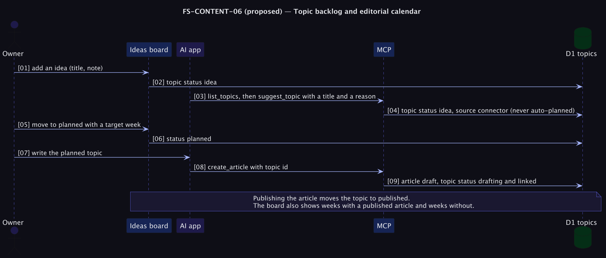

# FS-CONTENT-06 — Topic backlog and editorial calendar

**Status: Proposed (priority P2; supports the weekly cadence goal CG5).** Supports [PRD problem C1](../../../../tomlop-mobile-android/docs/product/prd-content-platform.md): the library cannot grow without a steady supply of good topics. The cadence assumption is a **[Hypothesis]** (H6).

## Table of Contents
1. [Meta](#1-meta-information) · 2. [Description](#2-description--use-case) · 3. [Pre/Post-conditions](#3-pre-conditions--post-conditions) · 4. [Contracts](#4-contracts) · 5. [Controls & States](#5-controls--states) · 6. [UI](#6-ui-flow--screen-wireframes) · 7. [Email](#7-email-templates) · 8. [Sequence](#8-technical-sequence-flows) · 9. [Security & Operations](#9-security--operational-controls) · 10. [Changes](#10-change-history) · 11. [Sign-off](#11-business-owner-sign-off)

## 1. Meta Information
| Field | Value |
|---|---|
| Flow ID | `FS-CONTENT-06` |
| Subdomain | Content & Publishing |
| Status | Proposed (priority P2; supports the weekly cadence goal CG5) |
| Version | 0.1.0 |
| Created | 2026-10-26 |
| Author | Chamrong, with Claude |

## 2. Description & Use Case
### 2.1 Business & UX Overview
A simple board of ideas: *idea → planned → drafting → in review → published* (or *dropped*), with a target week. The owner adds ideas; an AI app can **suggest** topics (never decide or plan them). When an article is created for a topic it is linked, and publishing it closes the topic. A weekly strip shows weeks with and without a published article, so a missed week is visible and calm, not a streak.

### 2.2 Technical System Logic
New table `topics` (migration `0006`): `id INTEGER PK`, `title_km`, `title_en`, `note`, `status` (`idea | planned | drafting | in_review | published | dropped`), `source` (`admin | connector`), `target_week TEXT` (ISO week), `article_id TEXT` (nullable), `created_at`, `updated_at`. MCP tools `list_topics` and `suggest_topic` (status forced to `idea`). The article-creation tools accept an optional `topic_id`.

## 3. Pre-conditions & Post-conditions
| Pre-conditions | Post-conditions |
|---|---|
| An admin session or a connector token (write scope) | A topic is linked to its article and closes on publish |

## 4. Contracts
| Endpoint or tool | Effect |
|---|---|
| `GET/POST /api/admin/topics`, `PUT/DELETE /api/admin/topics/:id` | Admin CRUD |
| `list_topics`, `suggest_topic` (MCP, write scope) | Read the board; add an `idea` with a reason |
| `create_article` gains `topic_id` | Sets the topic to `drafting` and links it |

## 5. Controls & States
| Item | Rule |
|---|---|
| Who plans | Only the admin moves a topic past `idea` |
| Connector suggestions | Marked `source = connector`, capped at 5 open ideas per app to avoid flooding |
| Cadence strip | Counts published articles per ISO week; no goals shown as failures |
| Privacy | Topics are internal; never exposed publicly |

## 6. UI Flow & Screen Wireframes
Admin → *Ideas*: a column board on desktop, a list on phones; each card shows the target week and the linked article; a weekly strip along the top.

## 7. Email Templates
Not applicable.

## 8. Technical Sequence Flows

## 9. Security & Operational Controls
Admin-only writes (connectors suggest only); same session and scope checks as other routes; plain text, escaped on render.

## 10. Change History
| Version | Date | Change |
|---|---|---|
| 0.1.0 | 2026-10-26 | First draft |

## 11. Business Owner Sign-off
### 11.1 Decisions proposed
**D1** AI may suggest, never plan. **D2** A calm cadence strip, no streak.
### 11.2 Approvals
Pending owner review; depends on FS-CONTENT-04 for scopes.
### 11.3 Constraints
**C1** Additive migration.
### 11.4 Out of scope
**O1** Public roadmap. **O2** Reader voting on topics (reader accounts are a non-goal).
### 11.5 Test cases
| ID | Case | Layer |
|---|---|---|
| T1 | A connector can suggest but not change status past idea | e2e |
| T2 | Creating an article with `topic_id` links and updates the topic | e2e |
| T3 | Publishing the article marks the topic published | e2e |
| T4 | The cadence strip counts correctly across year boundaries | Unit |
