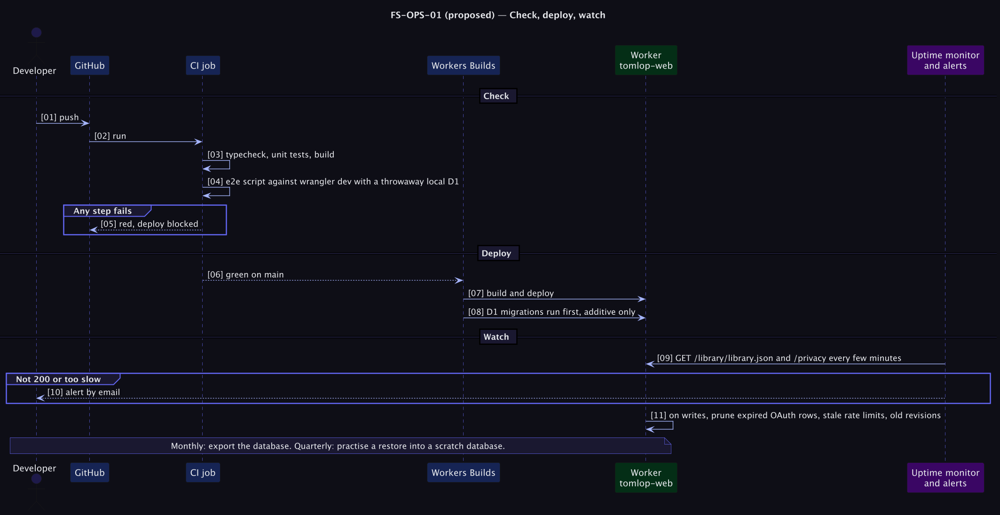

# FS-OPS-01 — Maintenance, CI and alerting

**Status: Proposed (priority P1 for CI, P2 for the rest).** Fixes [PRD problem C6](../../../../tomlop-mobile-android/docs/product/prd-content-platform.md) and risk R-10. Today a break is found by the owner noticing it.

## Table of Contents
1. [Meta](#1-meta-information) · 2. [Description](#2-description--use-case) · 3. [Pre/Post-conditions](#3-pre-conditions--post-conditions) · 4. [Contracts](#4-contracts) · 5. [Controls & States](#5-controls--states) · 6. [UI](#6-ui-flow--screen-wireframes) · 7. [Email](#7-email-templates) · 8. [Sequence](#8-technical-sequence-flows) · 9. [Security & Operations](#9-security--operational-controls) · 10. [Changes](#10-change-history) · 11. [Sign-off](#11-business-owner-sign-off)

## 1. Meta Information
| Field | Value |
|---|---|
| Flow ID | `FS-OPS-01` |
| Subdomain | Operations |
| Status | Proposed (priority P1 for CI, P2 for the rest) |
| Version | 0.1.0 |
| Created | 2026-10-26 |
| Author | Chamrong, with Claude |

## 2. Description & Use Case
### 2.1 Business & UX Overview
Three habits that keep a one-person service honest:
1. **Every push is checked** (types, unit tests, build, and the end-to-end script against a throwaway local database) and a red check blocks the deploy.
2. **Housekeeping needs no scheduler:** expired OAuth rows, stale rate-limit rows and old revisions are cleaned up as part of ordinary writes.
3. **Someone is told when it breaks:** an external uptime check on the feed and the privacy page, and a monthly export plus a quarterly practised restore.

### 2.2 Technical System Logic
- **CI** (GitHub Actions): `npm ci`, `nuxt typecheck`, `vitest`, `nuxt build`, then start `wrangler dev` with a fresh local D1 (migrate + seed) and run `scripts/e2e-local.py` with a CI-only admin credential. Workers Builds deploys only after the checks are green (branch protection requires the status).
- **Housekeeping:** `pruneExpired(db)` deletes `oauth_codes` and `oauth_tokens` expired more than a day ago, `rate_limits` past their window, and old revisions; it runs at most once an hour per isolate (a module-level timestamp) at the end of OAuth token issuance and article saves. A cron trigger was considered and rejected for now: it needs Nitro scheduled-task wiring that adds failure modes for a task this small ([ADR 0012](../../adr/0012-opportunistic-maintenance-and-ci.md)).
- **Alerting:** a free external monitor requesting `/library/library.json` and `/privacy` every few minutes with email alerts on non-200 or slow responses. **Verify the chosen provider's current free limits**; do not depend on the vendor for anything else.
- **Backups:** `wrangler d1 export` monthly to private storage; a restore into a scratch database each quarter (runbook).

## 3. Pre-conditions & Post-conditions
| Pre-conditions | Post-conditions |
|---|---|
| The repository has CI configured | A failing change cannot deploy |
| An uptime monitor exists | Housekeeping keeps tables small |
|  | An outage reaches the owner by email |

## 4. Contracts
Internal. CI configuration lives in `.github/workflows/ci.yml`; secrets for CI are throwaway values. `pruneExpired` has no public endpoint.

## 5. Controls & States
| Item | Rule |
|---|---|
| CI duration | Aim under 5 minutes; cache `node_modules` |
| Deploy gate | Required status check on `main` |
| Pruning frequency | At most hourly per isolate; bounded `LIMIT` per run so it cannot become slow |
| Alert thresholds | Non-200 twice in a row, or p95 over a few seconds (to be set from observation) |
| Drill | Quarterly: restore last export into a scratch DB and run the e2e against it |

## 6. UI Flow & Screen Wireframes
No UI. A one-page checklist in the runbook.

## 7. Email Templates
Not applicable.

## 8. Technical Sequence Flows

## 9. Security & Operational Controls
| Control | Note |
|---|---|
| CI credentials are separate and low-value | Never the production admin |
| The workflow cannot reach production secrets or the production database | Least privilege |
| Alerts contain no personal data | There is none to leak |

## 10. Change History
| Version | Date | Change |
|---|---|---|
| 0.1.0 | 2026-10-26 | First draft |

## 11. Business Owner Sign-off
### 11.1 Decisions proposed
**D1** CI blocks deploys. **D2** Opportunistic pruning instead of cron. **D3** An external uptime check.
### 11.2 Approvals
Pending owner review; CI needs the repository settings to be changed.
### 11.3 Constraints
**C1** Free tiers of the chosen CI and monitor.
### 11.4 Out of scope
**O1** Metrics dashboards. **O2** On-call rotations.
### 11.5 Test cases
| ID | Case | Layer |
|---|---|---|
| T1 | CI fails on a type error, a failing unit test, a failing e2e check | CI |
| T2 | A red check blocks the Workers Builds deploy | Manual |
| T3 | `pruneExpired` removes only expired rows and never a live token | Unit |
| T4 | Pruning runs at most once an hour per isolate | Unit |
| T5 | A deliberate outage triggers an alert email | Manual drill |
| T6 | A quarterly restore drill is recorded in the runbook | Process |
