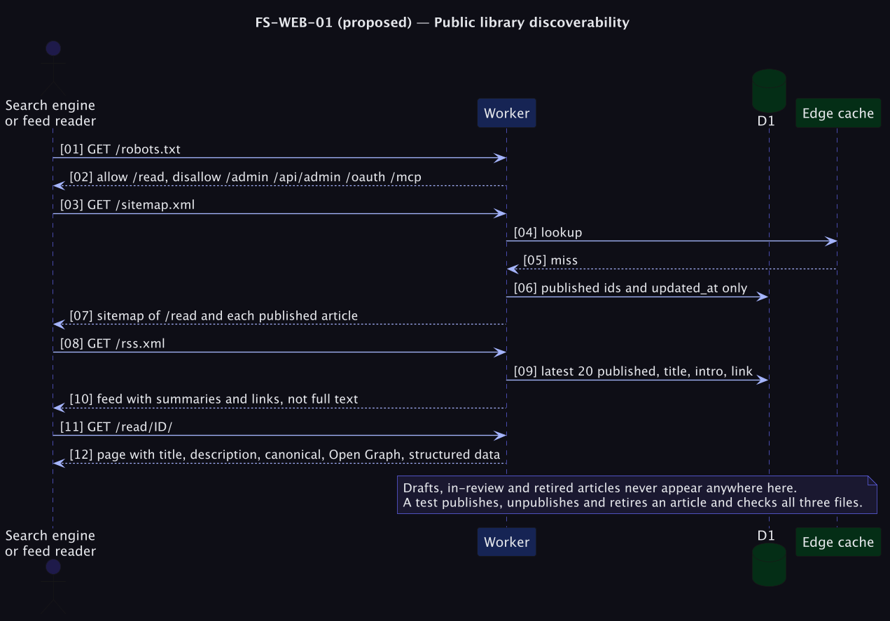

# FS-WEB-01 — Public library discoverability

**Status: Proposed (priority P2).** Reach is thin ([PRD problem P8](../../../../tomlop-mobile-android/docs/product/prd-android-app.md)); the public reading pages are the only part of Tomlop a search engine or a link can find. Value is a **[Hypothesis]**.

## Table of Contents
1. [Meta](#1-meta-information) · 2. [Description](#2-description--use-case) · 3. [Pre/Post-conditions](#3-pre-conditions--post-conditions) · 4. [Contracts](#4-contracts) · 5. [Controls & States](#5-controls--states) · 6. [UI](#6-ui-flow--screen-wireframes) · 7. [Email](#7-email-templates) · 8. [Sequence](#8-technical-sequence-flows) · 9. [Security & Operations](#9-security--operational-controls) · 10. [Changes](#10-change-history) · 11. [Sign-off](#11-business-owner-sign-off)

## 1. Meta Information
| Field | Value |
|---|---|
| Flow ID | `FS-WEB-01` |
| Subdomain | Public Website |
| Status | Proposed (priority P2) |
| Version | 0.1.0 |
| Created | 2026-10-26 |
| Author | Chamrong, with Claude |

## 2. Description & Use Case
### 2.1 Business & UX Overview
Make the articles findable and shareable: a sitemap, a robots file, proper page titles and descriptions, link previews, and an RSS feed. A person who sees an article link in a chat sees its title and first lines; a search engine knows which pages exist; a feed reader can follow the library. **Nothing unpublished ever appears.**

### 2.2 Technical System Logic
Routes: `/robots.txt`, `/sitemap.xml`, `/rss.xml` (Nitro routes, cached 300 s with the same purge as the feed). Per-article page head: `title`, `description` (first intro line, trimmed), canonical, Open Graph and Twitter tags, `lang=km`, and JSON-LD `Article` (headline, dateModified, inLanguage). A static brand image serves as the share card. The sitemap reads only `id, updated_at` of published rows; RSS reads title, first intro line and link of the newest 20 (a summary, not the full text, to send readers to the site).

## 3. Pre-conditions & Post-conditions
| Pre-conditions | Post-conditions |
|---|---|
| Articles are published | Only published articles appear in sitemap, RSS and page metadata |

## 4. Contracts
| Route | Content |
|---|---|
| `/robots.txt` | `Allow: /read`, `Disallow: /admin /api/admin /oauth /mcp`; links the sitemap |
| `/sitemap.xml` | `/`, `/read/`, `/privacy`, `/download`, and each published article with `lastmod` |
| `/rss.xml` | RSS 2.0, newest 20, `pubDate` from `updated_at` (the first-published date is a later addition) |

## 5. Controls & States
| Item | Rule |
|---|---|
| Canonical host | Always `https://tomlop.chamrong.com`; from config, never the Host header |
| Drafts, in-review, retired | Never listed anywhere; a test covers the whole lifecycle |
| Caching | 300 s with purge on write |
| Indexing admin | Blocked by robots and `X-Robots-Tag: noindex` on `/admin` (already set) |
| Cost | A few D1 row reads per cache miss |

## 6. UI Flow & Screen Wireframes
No UI beyond better link previews. Add a small *Follow by RSS* link in the library footer.

## 7. Email Templates
Not applicable.

## 8. Technical Sequence Flows

## 9. Security & Operational Controls
| Control | Note |
|---|---|
| Published-only queries | The single most important rule here |
| Output is XML-escaped | RSS and sitemap built with an escaping helper |
| Admin and OAuth paths are disallowed | Defence in depth, not a security control by itself |

## 10. Change History
| Version | Date | Change |
|---|---|---|
| 0.1.0 | 2026-10-26 | First draft |

## 11. Business Owner Sign-off
### 11.1 Decisions proposed
**D1** Summaries, not full text, in RSS. **D2** Config-derived canonical origin.
### 11.2 Approvals
Pending owner review.
### 11.3 Constraints
**C1** Free-tier row reads (cached).
### 11.4 Out of scope
**O1** Paid SEO tooling. **O2** Comments or sharing buttons with trackers.
### 11.5 Test cases
| ID | Case | Layer |
|---|---|---|
| T1 | A draft, an in-review article and a retired article appear in none of sitemap, RSS or page metadata | e2e |
| T2 | Sitemap and RSS are valid XML and escape special characters | Unit |
| T3 | Each article page has one canonical URL and the right title and description | e2e |
| T4 | `robots.txt` disallows the admin and OAuth paths | e2e |
| T5 | Responses are cached and purged on publish and unpublish | e2e |
