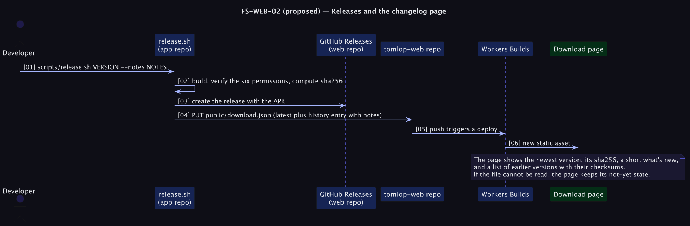

# FS-WEB-02 — Releases and the changelog page

**Status: Proposed (priority P2).** Trust for sideloaded installs ([risk R-18](../../../../tomlop-mobile-android/docs/product/risk-register.md)) and a visible record of improvements.

## Table of Contents
1. [Meta](#1-meta-information) · 2. [Description](#2-description--use-case) · 3. [Pre/Post-conditions](#3-pre-conditions--post-conditions) · 4. [Contracts](#4-contracts) · 5. [Controls & States](#5-controls--states) · 6. [UI](#6-ui-flow--screen-wireframes) · 7. [Email](#7-email-templates) · 8. [Sequence](#8-technical-sequence-flows) · 9. [Security & Operations](#9-security--operational-controls) · 10. [Changes](#10-change-history) · 11. [Sign-off](#11-business-owner-sign-off)

## 1. Meta Information
| Field | Value |
|---|---|
| Flow ID | `FS-WEB-02` |
| Subdomain | Public Website |
| Status | Proposed (priority P2) |
| Version | 0.1.0 |
| Created | 2026-10-26 |
| Author | Chamrong, with Claude |

## 2. Description & Use Case
### 2.1 Business & UX Overview
The download page shows the newest version with its checksum (today), and adds *What's new* and a list of **earlier versions with their checksums**, so a person can verify any build they were given and see how the app has changed. When the app is on Google Play, the page leads with Play and keeps the APK as the second choice.

### 2.2 Technical System Logic
`public/download.json` gains an additive `history` array (`version`, `releasedAt`, `apkUrl`, `bytes`, `sha256`, `notes` as short plain text, `minAndroid`) while keeping the current top-level fields so the existing page and older caches still work. `scripts/release.sh` already writes this file; it appends the new entry and keeps the latest 20. A Play link field `playUrl` (optional) switches the page's lead.

## 3. Pre-conditions & Post-conditions
| Pre-conditions | Post-conditions |
|---|---|
| A release was built and verified by `release.sh` | The page lists the newest version and prior versions with checksums |

## 4. Contracts
`download.json` (additive):
```json
{ "released": true, "version": "1.1.0", "apkUrl": "…", "bytes": 0, "sha256": "…", "releasedAt": "…", "minAndroid": "8.0",
  "playUrl": null, "history": [ { "version": "1.1.0", "releasedAt": "…", "apkUrl": "…", "sha256": "…", "bytes": 0, "notes": "…" } ] }
```

## 5. Controls & States
| Item | Rule |
|---|---|
| Notes | Plain text, written for users in Khmer and English; no links in the notes |
| Failure | If the file or `history` is missing, the page falls back to the current not-yet or latest view |
| Verification text | Keeps the existing "compare the SHA-256" guidance and a copy button |
| Old versions | Kept available only if their APK assets still exist on GitHub Releases |

## 6. UI Flow & Screen Wireframes
Download page: latest card, a *What's new* paragraph, then an *Earlier versions* list; a Play badge row when `playUrl` is set.

## 7. Email Templates
Not applicable.

## 8. Technical Sequence Flows


## 9. Security & Operational Controls
| Control | Note |
|---|---|
| Checksums come from the release script, computed from the exact APK uploaded | Single source |
| The page only links to the project's own GitHub Releases or Play | A link allow-list in the script |

## 10. Change History
| Version | Date | Change |
|---|---|---|
| 0.1.0 | 2026-10-26 | First draft |

## 11. Business Owner Sign-off
### 11.1 Decisions proposed
**D1** Additive `download.json`. **D2** Play first once live.
### 11.2 Approvals
Pending owner review; depends on the Play launch for the badge.
### 11.3 Constraints
**C1** The file stays small and static.
### 11.4 Out of scope
**O1** Automatic update checks inside the app (a new network use needing an ADR).
### 11.5 Test cases
| ID | Case | Layer |
|---|---|---|
| T1 | `release.sh` appends a history entry and keeps 20 | Script test |
| T2 | The page renders with and without `history` and `playUrl` | UI |
| T3 | Every listed checksum equals the APK's actual hash | Release checklist |
